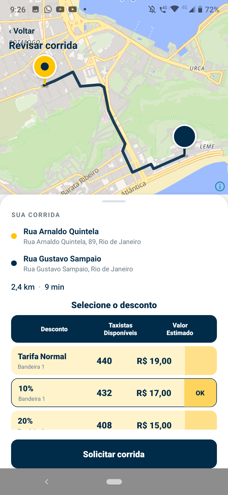

# Open Taxi RJ

[English version](README.en.md)

O **Open Taxi RJ** é uma reimplementação independente e de código aberto do cliente
**Passageiros** do aplicativo **Taxi.Rio**, da Prefeitura do Rio de Janeiro. O projeto
usa Expo, React Native e Android.

> Este é um projeto independente. Não é afiliado, mantido ou endossado pela Prefeitura
> do Rio de Janeiro, pelo Taxi.Rio ou pelos responsáveis pelo aplicativo oficial.

## Capturas de tela

<p align="center">
  
  
  
</p>

<p align="center">
  Origem, destino e escolha da tarifa.
</p>

## Por que criar um novo app?

Me irritava o fato do app Taxi.Rio não permitir mover o alfinete do mapa para o local
exato de partida, um recurso básico de usabilidade disponível há anos em outros apps
como Uber. No app original da prefeitura é necessário ficar tentando endereços até
encontrar o local certo.

Além disso, a comunidade de usuários poderá usar o aplicativo aberto para criar novas
funcionalidades que facilitem a vida do usuário e do taxista. Por exemplo, se a
prefeitura acrescentasse um campo de chave PIX ao cadastro do motorista seria possível
gerar um código PIX copia-cola ao término da corrida para agilizar o pagamento sem
digitação de valor, código PIX nem nada.

Repito o que sempre falo para os motoristas: não há nenhuma justificativa para que um
serviço de transporte prestado por um Brasileiro para outro Brasileiro seja intermediado
(e tenha que pagar taxa!) para uma empresa da Califórnia. Nenhum sentido.

## Funcionalidades

- Login por código enviado por **e-mail**, **SMS** ou **WhatsApp**.
- Cadastro de passageiro e recuperação de acesso por e-mail.
- Definição de origem e destino pelo mapa ou por busca de endereço.
- Histórico de endereços recentes ao focar o campo de origem ou destino.
- Histórico de corridas anteriores, com lista paginada e detalhes da corrida.
- Prévia da rota com distância e duração estimadas.
- Consulta de tarifas e descontos, com seleção da opção desejada.
- Solicitação de corrida com acompanhamento do status em tempo real.
- Mapa da corrida, rota, ETA, distância e dados do taxista.
- Contato telefônico com o taxista e cancelamento da corrida.
- Chat em tempo real com o taxista, incluindo mensagens rápidas.
- Resumo da tarifa final e avaliação da corrida com estrelas e comentário.
- Geração de código PIX Estático (copia e cola) com o valor final, quando o telefone do
  motorista está disponível.
- Gerenciamento dos dados da conta.
- Compatibilidade com o servidor fake local e com a API de produção.

O pagamento continua sendo acertado diretamente com o taxista (dinheiro ou PIX). Ao
final da corrida, o app pode gerar um código PIX Estático (copia e cola) com o valor
final quando o telefone do motorista está disponível, assumindo que esse número seja a
chave PIX dele. O app não processa pagamentos nem confirma transferências; confira o
nome do recebedor no app do banco antes de pagar.

## Requisitos para desenvolvimento

- Node.js 20 ou superior
- pnpm 9 ou superior
- JDK 17 ou superior, com `JAVA_HOME` configurado
- Android SDK configurado em `ANDROID_HOME`
- Android platform tools, incluindo `adb`
- Emulador Android ou aparelho com depuração USB habilitada

Este repositório contém apenas o projeto Expo. A pasta nativa `android/` é gerada e
ignorada pelo Git.

## Instalação das dependências

```sh
cd apps/mobile
pnpm install --frozen-lockfile
```

## Gerar o projeto Android

```sh
cd apps/mobile
pnpm android:prebuild
```

O comando recria `apps/mobile/android` a partir do `app.json` e dos plugins locais,
incluindo o módulo nativo de logs.

## Desenvolvimento

Inicie o Metro:

```sh
cd apps/mobile
pnpm start
```

Compile e instale a versão de desenvolvimento no emulador ou aparelho conectado:

```sh
cd apps/mobile
pnpm android
```

Verifique os tipos:

```sh
cd apps/mobile
pnpm typecheck
```

## Build do APK

Os valores `EXPO_PUBLIC_*` são incorporados ao bundle JavaScript durante o build. Ao
trocar entre o ambiente local e a produção, remova o bundle anterior antes de compilar:

```sh
cd apps/mobile
rm -rf android/app/build/generated/assets/react/release \
  android/app/build/intermediates/sourcemaps/react/release
```

### Build de produção

```sh
cd apps/mobile

rm -rf android/app/build/generated/assets/react/release \
  android/app/build/intermediates/sourcemaps/react/release

EXPO_PUBLIC_API_BASE_URL=https://api-passenger.app.taxi.rio \
EXPO_PUBLIC_WS_URL=wss://wss-passenger.app.taxi.rio \
EXPO_PUBLIC_RTDB_URL=https://taxi-rio.firebaseio.com \
EXPO_PUBLIC_FIREBASE_EMULATOR=0 \
pnpm android:release
```

O APK de produção pode ser copiado com:

```sh
cp android/app/build/outputs/apk/release/app-release.apk \
  dist/open-taxi-rj-real.apk
```

> O build de release atual usa a chave de depuração gerada pelo projeto. Ele serve para
> testes e instalação local, mas não deve ser distribuído como build oficial. Para uma
> distribuição real, configure uma keystore de release e a assinatura em
> `apps/mobile/android/app/build.gradle`.

### Build de desenvolvimento

O build local usa por padrão:

- API REST/WebSocket em `10.0.2.2:8081` no emulador Android
- Firebase RTDB em `10.0.2.2:9000`, namespace `taxi-rio`

O servidor fake local está em [`fake-server/`](fake-server/README.md), com instruções
para instalar dependências, subir a API e o RTDB, escolher cenários de corrida e rodar
os testes de contrato.

```sh
cd apps/mobile

rm -rf android/app/build/generated/assets/react/release \
  android/app/build/intermediates/sourcemaps/react/release

pnpm android:release
```

O APK será gerado em:

```text
apps/mobile/android/app/build/outputs/apk/release/app-release.apk
```

Também é possível copiá-lo para um caminho mais simples:

```sh
cp android/app/build/outputs/apk/release/app-release.apk \
  dist/open-taxi-rj-local.apk
```

## Logs de diagnóstico

A geração de logs é **desativada por padrão** e pode ser ligada no momento do build:

```sh
cd apps/mobile

rm -rf android/app/build/generated/assets/react/release \
  android/app/build/intermediates/sourcemaps/react/release

EXPO_PUBLIC_RIDE_LOG=1 pnpm android:release
```

Para um build de produção com logs:

```sh
cd apps/mobile

rm -rf android/app/build/generated/assets/react/release \
  android/app/build/intermediates/sourcemaps/react/release

EXPO_PUBLIC_API_BASE_URL=https://api-passenger.app.taxi.rio \
EXPO_PUBLIC_WS_URL=wss://wss-passenger.app.taxi.rio \
EXPO_PUBLIC_RTDB_URL=https://taxi-rio.firebaseio.com \
EXPO_PUBLIC_FIREBASE_EMULATOR=0 \
EXPO_PUBLIC_RIDE_LOG=1 \
pnpm android:release
```

A variável é lida em tempo de build. Alterá-la exige reconstruir o APK e limpar o bundle
anterior. Para desligar novamente, omita a variável ou use `EXPO_PUBLIC_RIDE_LOG=0`.
Com a opção desligada, o app não cria o arquivo de log.

Quando habilitado, o app grava linhas JSON em:

```text
/storage/emulated/0/Android/data/org.opentaxirj.client/files/logs/ride-session.log
```

O arquivo rotaciona ao atingir 32 MB. Para copiar o log de um emulador ou aparelho:

```sh
adb pull /sdcard/Android/data/org.opentaxirj.client/files/logs/ride-session.log
```

Os logs podem conter dados de diagnóstico, endereços e conteúdo de mensagens. Trate-os
como informação sensível e não os compartilhe publicamente sem revisão.

## Instalação do APK

Com o aparelho ou emulador conectado:

```sh
adb devices
adb install -r apps/mobile/android/app/build/outputs/apk/release/app-release.apk
```

Para instalar manualmente, copie o APK para o aparelho, permita a instalação de
aplicativos desconhecidos para o gerenciador de arquivos e abra o arquivo.

Se a instalação falhar por conflito de assinatura com uma versão anterior, remova a
versão instalada antes:

```sh
adb uninstall org.opentaxirj.client
```

> A remoção apaga os dados locais do aplicativo. Use com cuidado se houver uma sessão ou
> corrida em andamento.

## Configuração de ambiente

| Variável | Padrão no build local | Descrição |
| --- | --- | --- |
| `EXPO_PUBLIC_API_BASE_URL` | `http://10.0.2.2:8081` no Android | URL base da API REST |
| `EXPO_PUBLIC_WS_URL` | Derivada da API | URL do WebSocket |
| `EXPO_PUBLIC_RTDB_URL` | `http://10.0.2.2:9000?ns=taxi-rio` | URL do Firebase RTDB |
| `EXPO_PUBLIC_FIREBASE_EMULATOR` | `1` quando a RTDB é local | Usa o Firebase Emulator |
| `EXPO_PUBLIC_DRIVER_PHOTO_BASE_URL` | Derivada da API | Base das fotos dos taxistas |
| `EXPO_PUBLIC_RIDE_LOG` | `0` | Ativa os logs de diagnóstico com `1` |

## Identidade do cliente

O aplicativo se identifica como versão `4.1.20` e envia metadados do cliente nas
requisições REST, como identificador Android, sistema operacional e modelo do aparelho.
Os identificadores de cidade, pagamento e descontos fazem parte dos payloads normais da
API.

A especificação detalhada do protocolo está em [`docs/PROTOCOL.md`](docs/PROTOCOL.md),
em inglês.

## Licença

Este projeto está licenciado sob a licença MIT. Veja [`LICENSE`](LICENSE).
